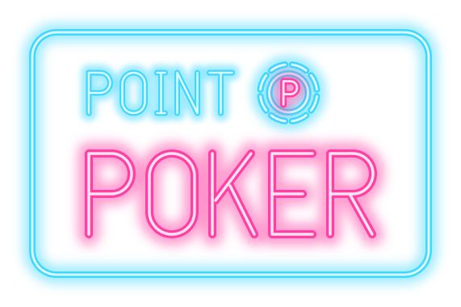

# Point Poker

A silly 3D story-point poker game for standups. The dealer puts a Jira ticket on the table,
everyone secretly plays a card, the cards flip, and the dealer calls the final points. The
closest guess wins the pot.

**Play:** https://point-poker.fly.dev · **Latest `main`:** https://point-poker-dev.fly.dev

## How to play

- **Dealer:** open a table (you sign in with Jira the first time) and share the invite link. Add a ticket (or an epic, to queue its
  children), reveal the cards, and pick the final points.
- **Players:** open the invite link, pick a body, colour and hat, and click a card. Drag to
  look around, press Z X C V to emote, click someone to throw a chip, and click the duck.

## Quick start

Requires Node 26.

```sh
npm install
npm run build
npm start                  # http://localhost:8787
```

For hot reload, run `npm run dev:server` and `npm run dev` together.

## Configuration

Everything is optional. Without Jira you type tickets in by hand. Locally, put the variables
in `.env.local`; you don't need Jira sign-in to work on the game
([Jira locally](CONTRIBUTING.md#jira-locally)).

| Variable                                         | What it does                                                                                                                                                   |
| ------------------------------------------------ | -------------------------------------------------------------------------------------------------------------------------------------------------------------- |
| `ATLASSIAN_CLIENT_ID`, `ATLASSIAN_CLIENT_SECRET` | Dealers sign in with their own Jira account to open a table, and tickets load with their access. [Setting up the Atlassian app](CONTRIBUTING.md#jira-sign-in). |
| `ATLASSIAN_CALLBACK_URL`                         | Sign in through another site's callback, like the dev site's for PR previews and local runs.                                                                   |
| `TOKEN_KEY`                                      | A long random string that seals those sign-ins on disk. Without it they are lost on restart.                                                                   |
| `JIRA_SITES`                                     | The Jira sites tables may use, like `acme.atlassian.net`. Without it any Atlassian account can open a table.                                                   |
| `JIRA_BASE_URL`, `JIRA_EMAIL`, `JIRA_API_TOKEN`  | Instead of sign-in: one shared API token for every table.                                                                                                      |
| `HOST_PASSCODE`                                  | With the shared token: required to open a table.                                                                                                               |
| `JIRA_POINTS_FIELD`                              | The story points field (default `customfield_10004`).                                                                                                          |
| `JIRA_PROJECT`                                   | The project whose sprints the ticket picker suggests.                                                                                                          |
| `DATA_DIR`                                       | Saves tables here, so restarts don't end games. Without it, tables live in memory.                                                                             |
| `PORT`                                           | Defaults to 8787.                                                                                                                                              |

## Status

Built for one team and still changing fast: the coin economy, the dealer's role and table
setup are all being reworked, and there is one room so far. Nothing writes to Jira yet, so the
final points are entered there by hand. Plans live in the
[issues](https://github.com/Americastestkitchen/point-poker/issues).

## Contributing

[CONTRIBUTING.md](CONTRIBUTING.md) covers checks, deploys and releases.
[AGENTS.md](AGENTS.md) covers the constraints and conventions the code doesn't show. To read
the code, start at `shared/protocol.ts`: every message between server and browser.
